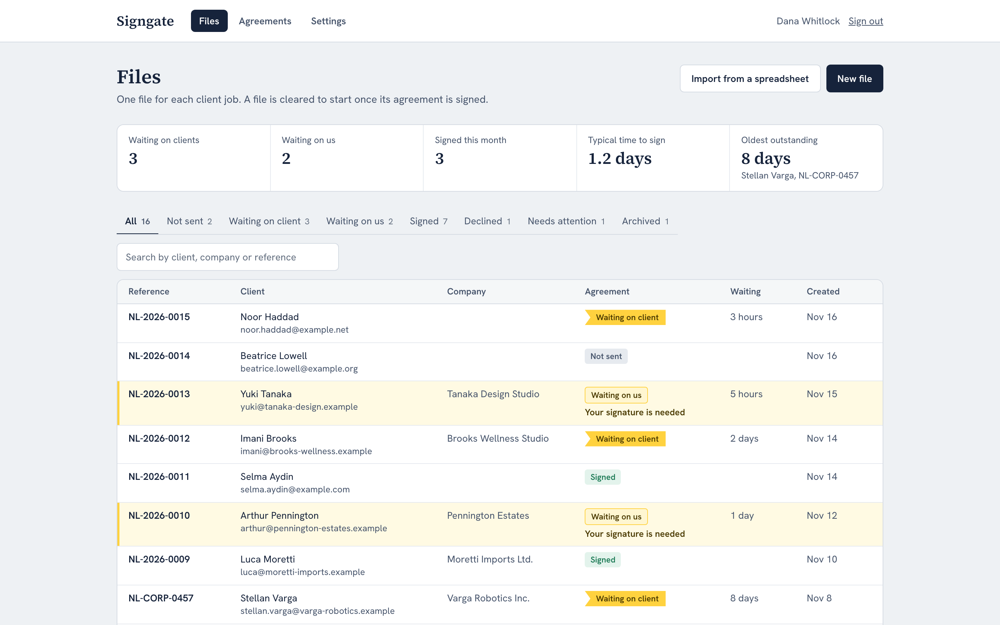
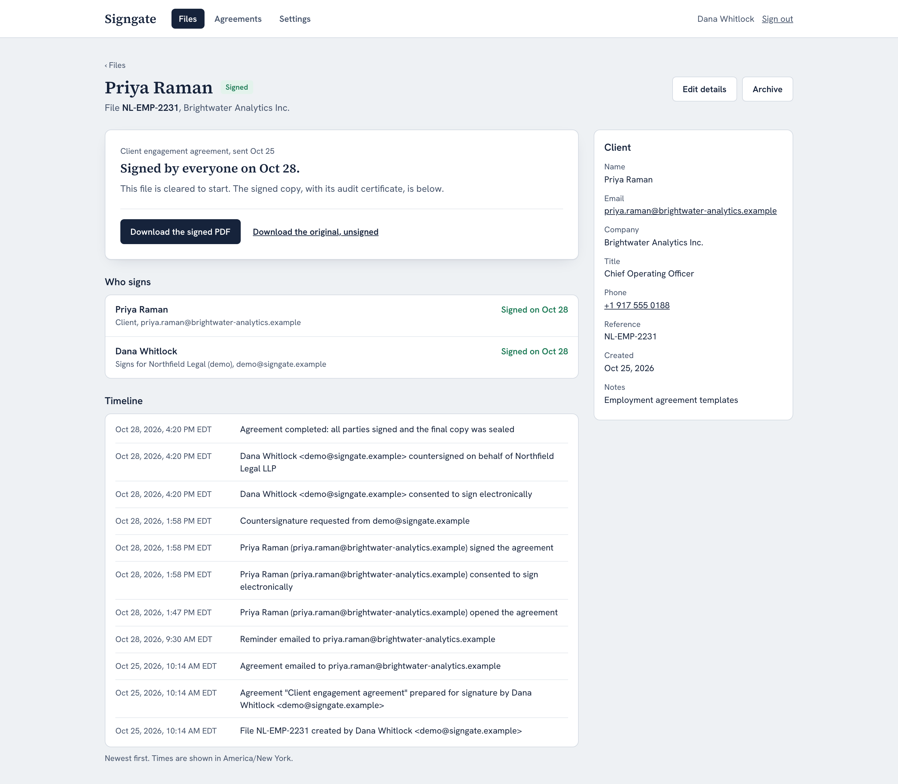
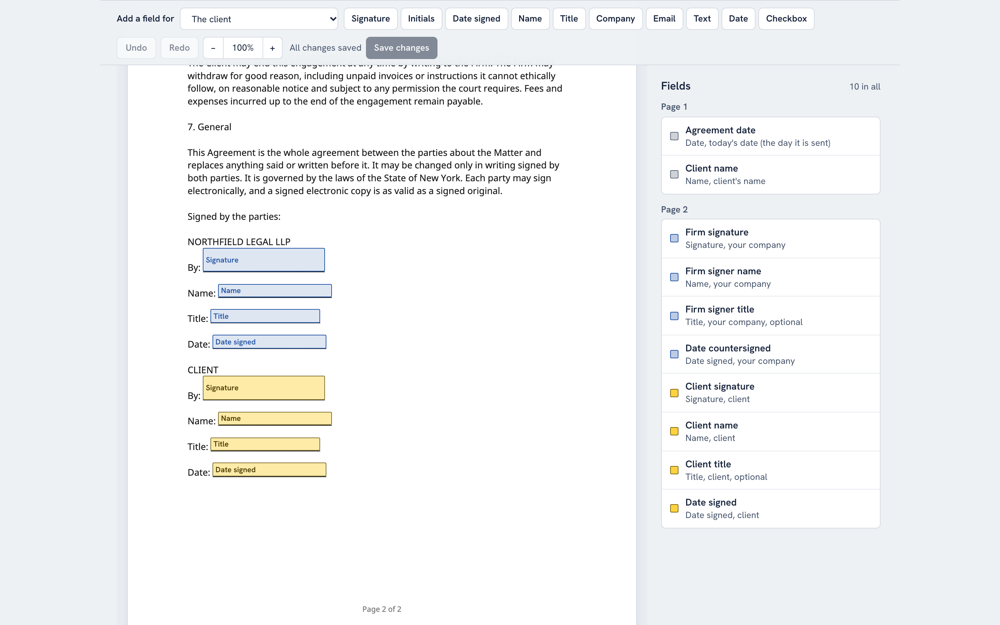
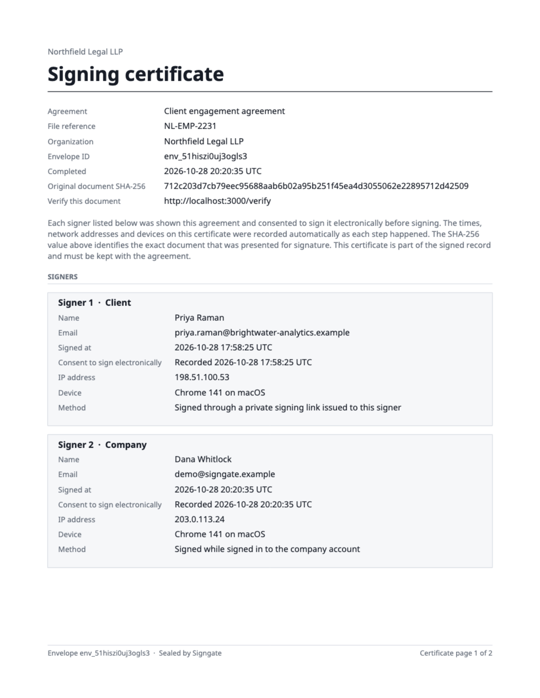
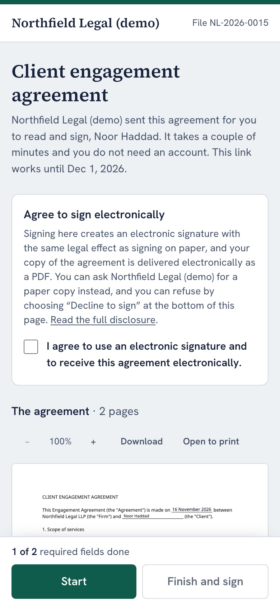

# Signgate

Signgate gets a company's standard client agreement signed on every file, automatically.

A company adds its agreement once, in whatever form it exists today. From then on, opening a file
(one job or case for one client) sends that agreement for signature, chases the client until it is
signed, collects the company's countersignature, and stores a sealed PDF with an audit certificate.
The file shows as signed, and work can start.

Live: https://signgate-theta.vercel.app

## What it looks like

| | |
| --- | --- |
|  |  |
| The files list: what is waiting on clients, what is waiting on you, and what is signed. | A signed file: the sealed PDF to download and the full timeline of who did what, and when. |
|  |  |
| Reviewing an agreement: the fields Signgate found, drawn on the document, yellow for the client and blue for your company. | The signing certificate sealed into every signed PDF: signers, times, devices and the document's fingerprint. |



What the client sees on their phone: no account, the agreement itself, and a guided path to "Finish and sign".

The screenshots show the fictional demo company described under [Demo data](#demo-data).

## How it works

1. **Add your agreement.** Upload a PDF, a Word document, an image or pasted text. Signgate has never
   seen it, so it reads the layout and proposes where the client signs, where your company signs, and
   which blanks it can fill in itself (client name, date, file number). You review the proposal on top of
   the document, correct anything by dragging, and activate it.
2. **Open a file.** Enter the client's name and email, import a spreadsheet, call the API from your
   case system, or give clients a link to start their own file. The agreement goes out by email.
3. **It gets signed.** The client reads and signs on their phone with no account. Reminders go out on
   a schedule. Your side is countersigned by hand or automatically with a saved signature. Everyone
   receives the sealed PDF, and the file is marked signed.

## What is in the box

| Area | What it does |
|---|---|
| Any agreement | PDF, .docx, PNG, JPEG, text. Type is decided from content, not the filename. Rotated pages, crop boxes and fillable PDF forms are handled. A locked PDF is converted in the browser. If no place to sign is found, a signature page is appended, so every agreement is signable. |
| Field detection | Rule-based reading of the page geometry: signature lines, labels above or below lines, two-column and table signature blocks, blocks split across pages, initials, blanks in the body. An optional AI pass (Anthropic) can reclassify candidates but cannot invent positions. |
| Field editor | Fields drawn on the document: move, resize, add, delete, change who fills each one, undo, keyboard control, readiness checklist, preview with sample values. |
| Files | List with status filters and search, create, edit, archive, CSV import with a per-row preview, dashboard counts. |
| Signing | Mobile-first public page: consent to sign electronically, guided field-by-field, draw / type / upload a signature, decline with a reason, honest screens for expired, voided and already-signed links. |
| Lifecycle | Reminders, expiry, countersignature (manual or automatic), void, resend, correct the client's email, send again. Every transition is a guarded transaction, so double clicks and retries cannot sign twice. |
| Sealed record | Values stamped on the PDF, a certificate page with each signer's consent, time, IP and device plus the full timeline, and a SHA-256. Anyone can check a PDF on the public verify page; the file is hashed in the browser and never uploaded. |
| Companies and teams | Multi-tenant from the first table. Owner, admin and member roles, invitations, branding, signing defaults, time zone. |
| Integration | REST API with keys, idempotency and rate limits; signed webhooks with retries; a public intake link per agreement; API reference at `/docs/api`. |
| Email | Sent in the company's name. Every attempt is logged; a failed delivery is shown to the sender, and the signing link is always available to share by hand. |

## Run it locally

```bash
npm install
npm run dev
```

No database or accounts are needed: without `DATABASE_URL` the app runs on an embedded Postgres
(PGlite) stored in `.data/`. Without email settings, nothing is sent and signing links are shown in the
interface. See `.env.example` for every setting.

```bash
npm run typecheck   # TypeScript, strict
npm test            # unit and service tests against an in-memory Postgres
npm run test:e2e    # Playwright journeys in a real browser, client side on a phone profile
npm run lint
```

## Demo data

```bash
DEMO_PASSWORD='<at least 10 characters>' npm run seed:demo
```

Creates one fictional company, "Northfield Legal (demo)", so you can sign in as `demo@signgate.example`
and see the product in use: an active engagement agreement, a second one in draft, a team member, and
17 files across every state (signed and sealed, waiting on the client, waiting on countersignature,
declined, voided, expired, not sent, archived) spread over the last month. The data is produced by
running the real lifecycle through the service layer, so the signed PDFs download and verify.

Safety rules the script enforces:

- **It never sends email.** It refuses to start if `RESEND_API_KEY` or `SMTP_USER` is set, and it keeps
  every message in memory and discards it.
- **It runs once.** If `demo@signgate.example` already exists it says so and changes nothing.
- **It only creates the demo company.** No other company's data is read or changed.
- **Everything in it is invented.** Names are made up and addresses use reserved example domains.
- It writes to whatever database the app would use: `DATABASE_URL` if set, otherwise the local `.data/pglite`.
  Stop `npm run dev` first when seeding the local database, since the embedded database allows one process at a time.
  Against a hosted database it also requires that deployment's `APP_SECRET` (signing links are derived
  from it) and `APP_URL` (the verification address printed on sealed PDFs).

## Deploy

Vercel plus any Postgres (Neon is used for the live instance).

| Variable | Purpose |
|---|---|
| `DATABASE_URL` | Pooled Postgres connection. Migrations run in the build step. |
| `DATABASE_URL_UNPOOLED` | Optional direct connection for migrations. |
| `APP_SECRET` | 32+ random characters. Signing-link secrets are derived from it. |
| `CRON_SECRET` | Authorizes `/api/cron` (reminders, expiry, retries). |
| `RESEND_API_KEY` + `EMAIL_FROM` | Email through Resend with a verified domain, or |
| `SMTP_USER` + `SMTP_PASS` | email through SMTP (Gmail by default). |
| `ANTHROPIC_API_KEY` | Optional AI pass for field detection. |
| `APP_URL` | Optional public base URL for emailed links. |

## Structure

```
src/lib/pdf/        document engine: ingest, text and line extraction, field detection, stamping, sealing
src/lib/services/   all business logic and every database write
src/lib/db/         schema (Drizzle) and the database handle
src/app/(app)/      the signed-in product
src/app/sign/       the public signing page
src/app/api/v1/     the REST API
tests/unit/         Vitest
tests/e2e/          Playwright
```

Design decisions, what was left out and why: see [SUBMISSION.md](SUBMISSION.md).
